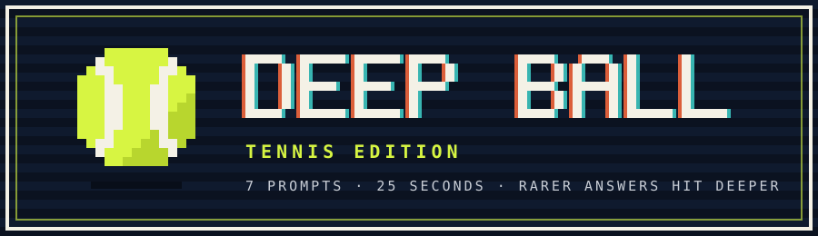
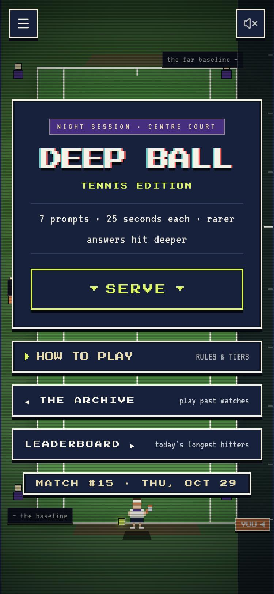
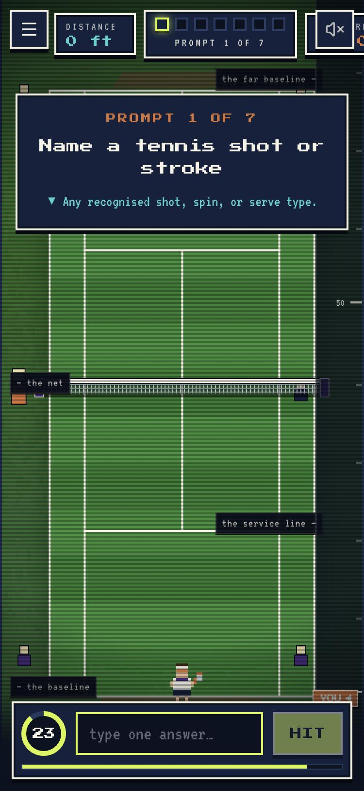
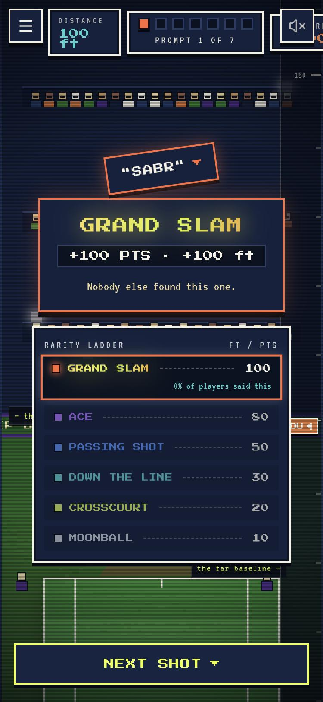
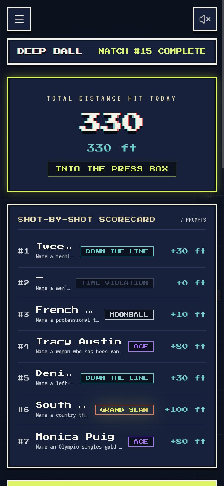
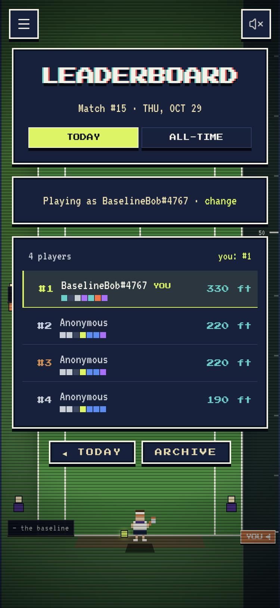
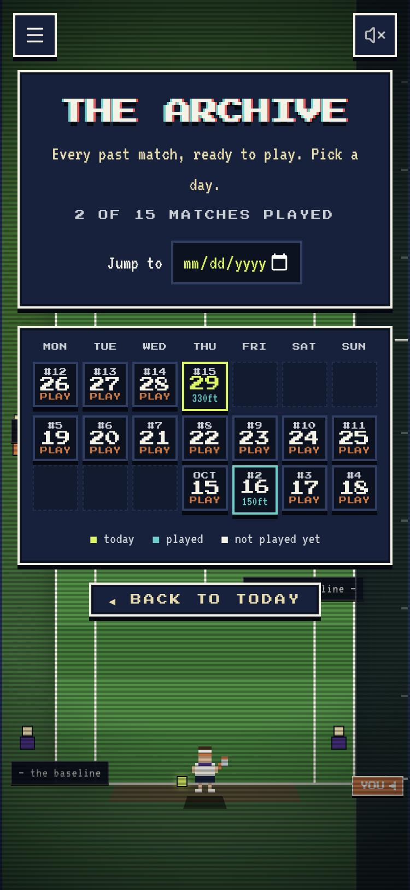
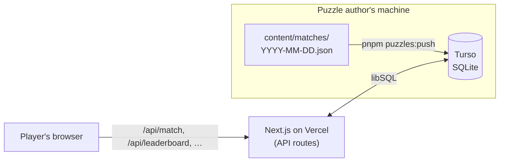

<p align="center">
  <a href="https://deep-ball.vercel.app"></a>
</p>

<h3 align="center">The daily tennis trivia game where the <i>rarest</i> right answer wins.</h3>

<p align="center">
  <a href="https://deep-ball.vercel.app"></a>
</p>

<p align="center">
  
  
  
  
  <br>
  
  
  
</p>

<p align="center">
  <a href="#how-to-play">How to play</a> ·
  <a href="#scoring">Scoring</a> ·
  <a href="#features">Features</a> ·
  <a href="#how-it-works">How it works</a> ·
  <a href="#run-it-locally">Run locally</a> ·
  <a href="#writing-puzzles">Puzzles</a> ·
  <a href="#deploying">Deploy</a>
</p>

<p align="center"><i>An independent fan project. Not affiliated with the ATP, WTA, ITF or any tournament.</i></p>

---

## Screenshots

<table>
  <tr>
    <td align="center" width="33%"><br><sub><b>Serve.</b> A new match every day at midnight ET.</sub></td>
    <td align="center" width="33%"><br><sub><b>25 seconds.</b> One answer per prompt.</sub></td>
    <td align="center" width="33%"><br><sub><b>Go deep.</b> Nobody else said <i>SABR</i>: Grand Slam.</sub></td>
  </tr>
  <tr>
    <td align="center"><br><sub><b>Scorecard.</b> Every shot, tier and foot.</sub></td>
    <td align="center"><br><sub><b>Leaderboard.</b> Pick a nickname, chase #1.</sub></td>
    <td align="center"><br><sub><b>Archive.</b> Play any past day.</sub></td>
  </tr>
</table>

## How to play

1. **Hit SERVE.** Today's match has **7 prompts**, like *"Name a tennis shot or stroke"* or *"Name a left-handed player"*.
2. **Type one answer in 25 seconds.** Spelling doesn't have to be perfect: accents, capitals, a surname on its own and small typos all count.
3. **Wrong answer? That's a FAULT.** Try again while the clock is running. If time runs out, it's a **time violation** (0 ft).
4. **Rarer answers hit deeper.** *Federer* is a safe Moonball. A name almost nobody else thinks of flies into the stands as a **Grand Slam**.
5. **Add up your feet.** Seven shots make your total distance. See where you rank, share your grid, and come back tomorrow to keep your streak going.

```
DEEP BALL #15 🎾 330 ft
🟩⬛⬜🟪🟩🟥🟪
```

## Scoring

How deep a shot goes depends on **how many players gave the same answer**. Rarity starts from the puzzle author's estimate and shifts toward real answers as more people play.

| | Tier | Share of players who said it | Distance |
|:-:|---|---|--:|
| 🟥 | **GRAND SLAM** | under 0.05% | **100 ft** |
| 🟪 | **ACE** | 0.05% – 0.3% | 80 ft |
| 🟦 | **PASSING SHOT** | 0.3% – 1% | 50 ft |
| 🟩 | **DOWN THE LINE** | 1% – 4% | 30 ft |
| 🟨 | **CROSSCOURT** | 4% – 10% | 20 ft |
| ⬜ | **MOONBALL** | 10% or more | 10 ft |
| ⬛ | **TIME VIOLATION** | the clock ran out | 0 ft |

A perfect match is 700 ft.

## Features

- 🎾 **One shared match a day:** everyone gets the same 7 prompts, unlocked at midnight ET.
- 🏆 **Leaderboards:** today's longest hitters plus an all-time board of total feet, with current streaks. Pick a nickname (no account needed) and get a `#tag` so names can repeat.
- 📅 **Archive:** a calendar of every past match. Archive games count toward your totals but not your streak or the daily board.
- 📊 **Stats:** streak, best streak, average, best match and Grand Slam count, saved on the server and cached in your browser.
- 📈 **The draw:** a distribution curve of everyone's distances with your percentile. It uses an estimated spread until enough people have played.
- ⏱️ **A shot clock that can't be cheated:** the 25 seconds is timed on the server. Refreshing or switching tabs doesn't reset it.
- 🔒 **Answers stay secret:** answer lists never reach the browser. Only the server checks guesses.
- 📋 **Share grid:** the emoji summary above, one tap to copy.
- 📱 **Built for phones:** pixel-art court, retro sound effects (off by default), no sign-up.

## How it works



- **No accounts.** Each player gets an anonymous, `httpOnly` cookie. Nicknames are optional and attach to that cookie.
- **Scoring on the server.** A guess is normalized (accents, punctuation and a leading "the" are stripped), then matched against canonical names, aliases, unique surnames and close typos. Its rarity is:
  `share = (author's estimate + real picks) / (1,000 imaginary players + real answers)`.
  Early on the estimate dominates; as more people play, real answers take over.
- **Puzzle files stay private.** They hold every answer, so they're kept out of this public repo and uploaded straight to the database.
- **One small database.** Matches, prompts, answers, plays, results and nicknames all live in a single SQLite database: Turso in production and a local file in development.

## Run it locally

You need **Node 24+** (it's developed on Node 26) and **pnpm**.

```bash
git clone https://github.com/saiharshilk/deep-ball.git
cd deep-ball/deep-ball
pnpm install
pnpm dev               # http://localhost:3000
```

Puzzle files aren't in the repo, so a fresh clone starts with none. Add at least one `content/matches/YYYY-MM-DD.json` for today; the format is in [`deep-ball/content/README.md`](deep-ball/content/README.md). Local development uses `data/deepball.db` and needs no accounts or keys.

| Command | What it does |
|---|---|
| `pnpm dev` | Run the game locally with hot reload |
| `pnpm build` / `pnpm start` | Production build and server |
| `pnpm puzzles:check` | Validate every puzzle file and show how many days are scheduled |
| `pnpm puzzles:push` | Upload puzzle files to the database set in `.env.turso` |

Handy for testing: `GAME_DATE=2026-11-03 pnpm dev` pretends it's a different day.

## Writing puzzles

Each day is one JSON file with 7 prompts. Every answer has a name, optional aliases and a rarity estimate:

```json
{ "name": "Rafael Nadal", "aliases": ["rafa"], "pct": 40 }
```

`pnpm puzzles:check` catches mistakes: wrong prompt counts, broken numbering and aliases shared by two answers. The full guide is in [`deep-ball/content/README.md`](deep-ball/content/README.md).

## Deploying

The game runs for free on **Vercel + Turso** (no credit card). The step-by-step guide is in [`deploy/README.md`](deploy/README.md). Once it's live, `/api/health` shows which database the site uses and whether today's puzzle is loaded.

## Project structure

```
deep-ball/
├── app/                 pages (/, /play, /archive, /leaderboard) and API routes (app/api)
├── components/          court scene, HUD, prompt card, scorecard, leaderboard UI
├── hooks/useGame.ts     the match state machine and shot clock
├── lib/server/          database, scoring, answer matching, leaderboards, profiles
├── content/             puzzle guide (puzzle files are kept out of git)
└── scripts/             puzzles:check and puzzles:push
deploy/README.md         hosting guide (Vercel + Turso)
```

## Feedback

Found an answer that should have counted, or a prompt that's unfair? [Open an issue](https://github.com/saiharshilk/deep-ball/issues). Missing answers are the most useful feedback a rarity game can get.

<p align="center"><sub>Built with Next.js · Pixel art and sound made in code · 🎾 See you on court tomorrow.</sub></p>
